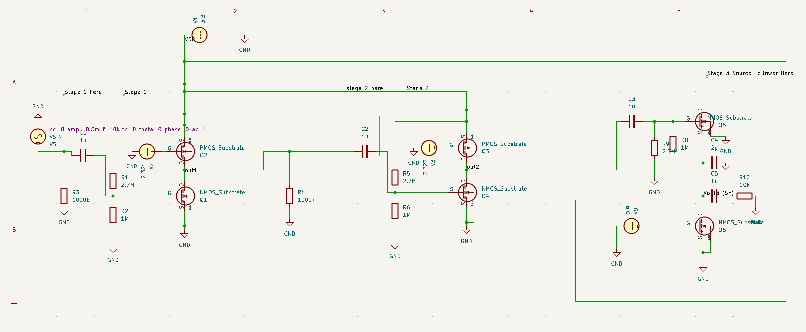
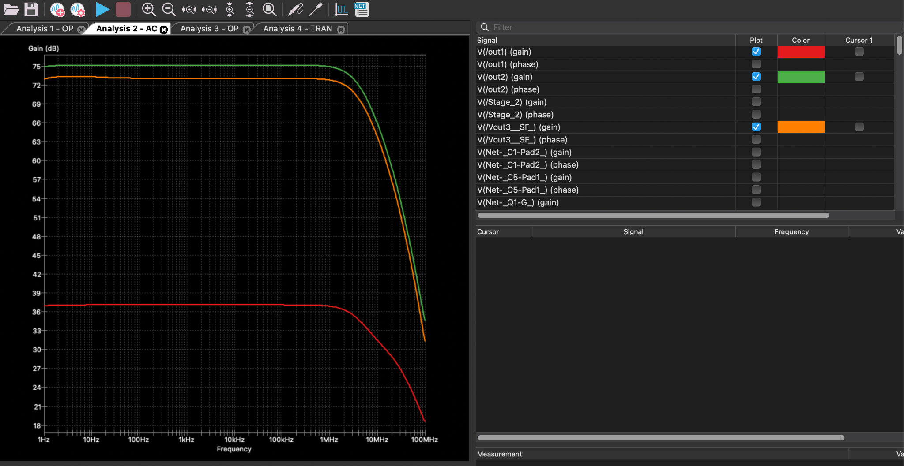
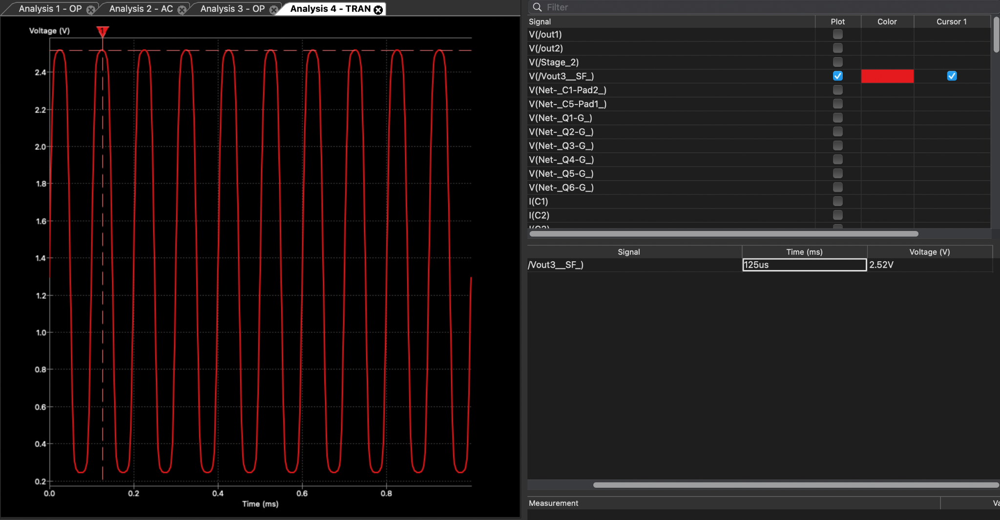

# Three-Stage MOSFET Voltage Amplifier | KiCad & SPICE

An open-loop, transistor-level voltage amplifier designed using two common-source gain stages and a source-follower output buffer.



## Project overview

The objective was to design and simulate a MOSFET amplifier powered from a **3.3 V supply**, achieving high voltage gain and wide bandwidth while driving a **10 kΩ / 2 pF load**. The circuit uses discrete transistor-level stages, with device sizing and bias selection supported by hand calculations and SPICE simulations.

### Architecture

| Stage | Configuration | Function | Reported simulated gain |
| --- | --- | --- | ---: |
| 1 | Common-source | First high-gain voltage amplification stage | ~37.1 dB |
| 2 | Common-source | Additional voltage gain | ~38.2 dB incremental |
| 3 | Source follower (common-drain) | Output buffering and load drive | ~−2.3 dB incremental |

**Signal path:** `Input → Common Source (CS1) → Common Source (CS2) → Source Follower → 10 kΩ / 2 pF load`

The two common-source stages provide gain, while the source follower helps drive the output load at reduced output impedance. The source follower's loaded voltage gain is less than unity.

## Results and design targets

*The values below are transcribed from the submitted project report; they have not been independently re-simulated for this repository.*

| Metric | Target | Reported result | Assessment |
| --- | ---: | ---: | --- |
| Overall voltage gain | ≥ 60 dB | ~73–74 dB | Meets |
| Bandwidth | ≥ 500 kHz | ~3.91 MHz | Meets |
| Peak-to-peak output swing | ≥ 1.5 Vpp | ~2.277 Vpp | Meets |
| Input resistance | ≥ 100 kΩ | ~730 kΩ | Meets |
| Maximum branch current | ≤ 200 µA | ~137 µA | Meets |
| Loaded gain reduction | ≤ 10% | ~23.3% (report's value) | **Exceeds limit** |
| Power consumption | ≤ 1.0 mW | ~1.01 mW (calculated) | **Slightly exceeds limit** |

The report gives a manual gain estimate of **78.8 dB** and an AC simulation result of approximately **73 dB** (rounded to 74 dB in its performance table). These are estimates from different methods, not separate tested versions of the circuit.

> **Measurement note:** The report calls the gain change from the second-stage output to the source-follower output a 2.3 dB reduction and labels it ~23.3%. The comparison is based on stage-to-stage gain, rather than a dedicated loaded-versus-unloaded test. The 10% load-sensitivity requirement therefore needs a separate verified measurement before claiming compliance.

## AC frequency response



The AC analysis compares the first-stage, second-stage, and final-output gain responses. The report identifies approximately **3.91 MHz bandwidth** and a final midband voltage gain of approximately **73 dB**.

## Transient response and output swing



The reported transient output voltage varies from roughly **0.243 V to 2.52 V**, giving:

`Vpp = 2.52 V − 0.243 V = 2.277 V`

The report notes some large-signal compression near the output peaks.

## Design details

- **Technology:** NMOS and PMOS devices using provided 3.3 V SPICE transistor models
- **Supply:** 3.3 V
- **Gain stages:** two common-source stages
- **Output stage:** one source follower
- **Load:** 10 kΩ resistor in conjunction with 2 pF capacitance
- **Biasing:** resistive bias network and fixed DC bias sources
- **EDA tools:** KiCad schematic editor and SPICE simulation

### Transistor sizing (from report)

| Devices | Type | Width | Length | W/L |
| --- | --- | ---: | ---: | ---: |
| Q1, Q4 | NMOS | 12 µm | 0.5 µm | 24 |
| Q2, Q3 | PMOS | 48 µm | 0.5 µm | 96 |
| Q5 | NMOS | 80 µm | 0.5 µm | 160 |
| Q6 | NMOS | 19 µm | 0.5 µm | 38 |

## Repository layout

```text
three-stage-mosfet-amplifier/
├── README.md
├── images/
│   ├── circuit-schematic.png
│   ├── ac-frequency-response.png
│   └── transient-output-swing.png
├── hardware/
│   ├── Kritagya_ELE 404 Final Proj.kicad_pro
│   └── Kritagya_ELE 404 Final Proj.kicad_sch
└── docs/
    └── design-report.pdf
```

The downloadable **local complete package** also has a `models/` directory containing the provided NMOS and PMOS SPICE models. These may have redistribution restrictions and should **only** be published with permission from the model owner. The public package omits them by default.

## Opening the project and running simulations

1. Install a compatible version of **KiCad** (the submitted schematic was saved by KiCad 10.0).
2. Open `hardware/Kritagya_ELE 404 Final Proj.kicad_pro` in KiCad.
3. For SPICE simulation, obtain the **original transistor model files** from an authorized source and place them at `models/nmos_t.txt` and `models/pmos_t.txt` relative to the repository root.
4. Confirm that each MOSFET's **Sim.Library** path resolves to its corresponding model file. Paths were changed from a personal computer's absolute paths to relative paths for portability.
5. Configure and execute DC operating-point, AC sweep, and transient analyses in KiCad's simulator. The report documents expected results; simulator commands and waveforms have **not** been provided as a fully reproducible automated test bench.

**Important:** Without the matching technology models, the schematic can be viewed but its original SPICE results cannot necessarily be reproduced. No physical PCB or fabricated IC is claimed here; this is a schematic/simulation project.

## Engineering observations

- Cascading two common-source amplifiers provides strong voltage gain, but a source-follower output buffer introduces some loss under load.
- The design exceeded gain, bandwidth, swing, input-resistance, and branch-current targets, while showing tradeoffs in loaded gain reduction and power.
- Hand calculations provide a useful first approximation, whereas device-level SPICE modeling captures additional loading and non-ideal behavior.


## Author

**Kritagya Sharma** 
